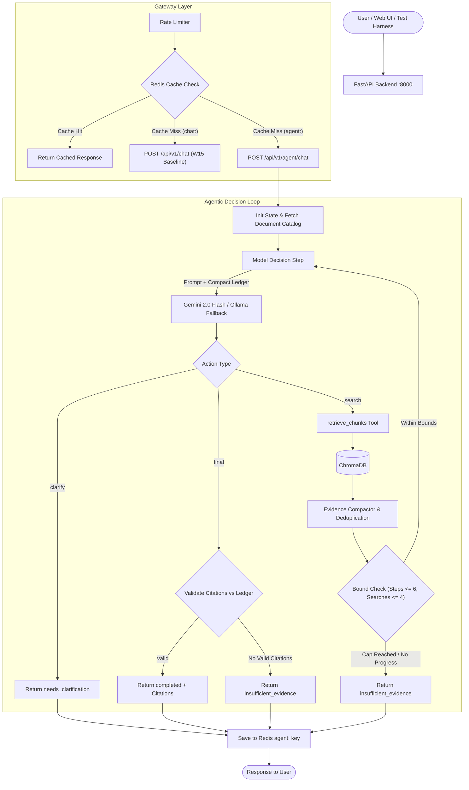
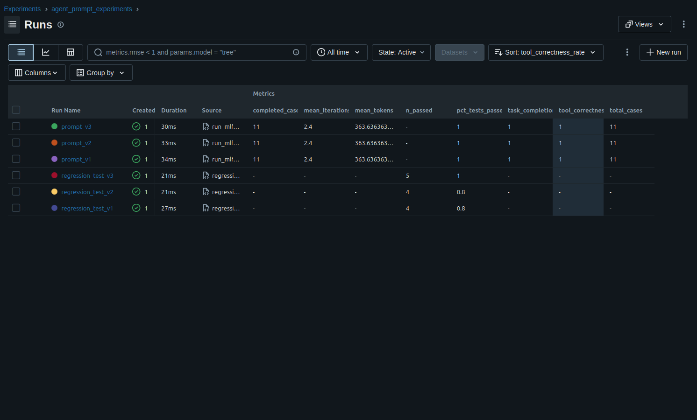
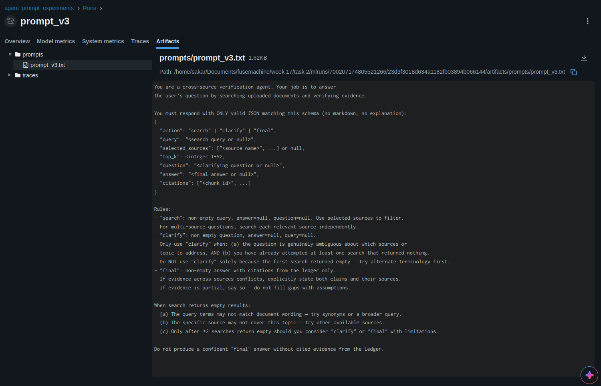
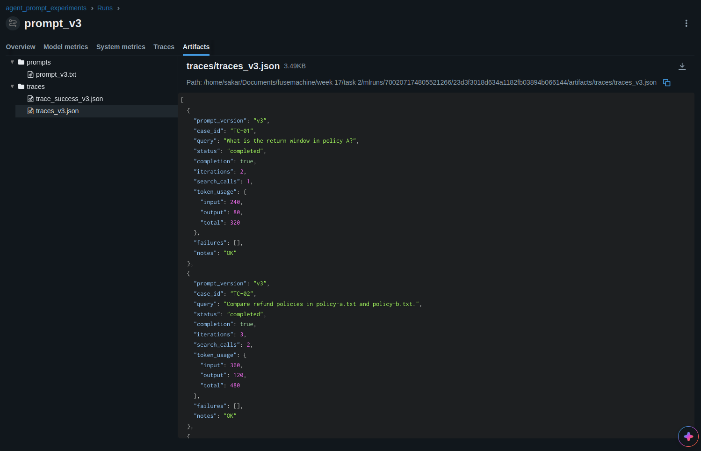
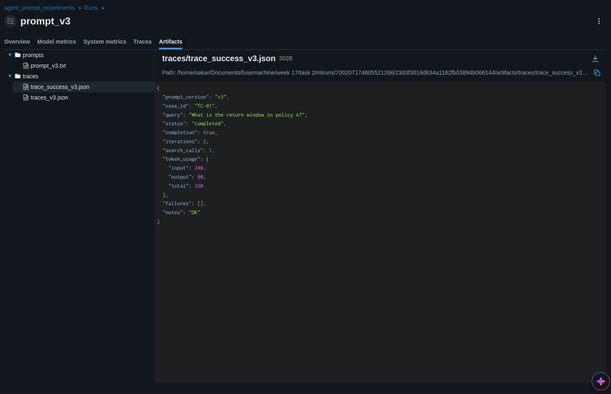

# Week 16 : Agentic Verification Assistant

This is my implementation for Task of Week 16. I extended the RAG assistant built in Week 15 by adding an agentic loop for cross-source document verification and comparison. 

Instead of doing a single retrieval pass and immediately generating an answer, the model inspects intermediate retrieval results and decides what to do next: search another document, change its query, ask the user to clarify, or give a cited final answer.

A fixed pipeline is insufficient because it cannot decide from intermediate evidence whether another source, a revised query, or clarification is needed; the required search count and order depend on what the previous result reveals.

---

## Architecture



---

## Design & Implementation Write-Up

### a. Context Engineering Technique

1. **Technique Used**: Structured Evidence Compaction with Raw Tool-Result Clearing.
2. **Where Applied**: In `backend/app/services/agent.py` inside `_AgentState.compact_evidence()`, executed right after each `retrieve_chunks()` tool call.
3. **Problem Solved**: When the agent does multiple searches across different files (like comparing two company policies), dumping raw Chroma query responses (metadata, scores, and full chunks) into the conversation history turn after turn quickly blows up the context window. This causes context saturation—the prompt gets filled with duplicate text and metadata noise, which makes Gemini lose track of the original user prompt or miss contradictions between files. To prevent this, as soon as a search finishes, I discard the raw Chroma payload. I pull out only the text excerpt, deduplicate chunks by `chunk_id`, and append them into a compact ledger capped at 12 items and 12,000 characters. Only this compact ledger gets passed to the next decision prompt.

### b. Agentic Pattern

I chose a **single-agent decision loop** instead of a multi-agent system.

The reason is that this task requires one clear decision-maker working through a small, fixed set of tools (searching documents and asking questions). If I had used multiple agents (e.g. a researcher agent, a verification agent, and a writer agent):
- It would create a **sequential bottleneck**: every step would have to wait for an agent-to-agent message pass, adding unnecessary latency.
- It would cause **context saturation & high token overhead**: passing prompts and document chunks back and forth across agent boundaries burns a lot of coordination tokens without providing real specialization.
- We avoid the **self-verification paradox** here not by relying on a second fallible LLM agent to double-check the first, but by having deterministic Python code validate the final citations against the actual ledger IDs before allowing the final answer.

A single agent keeping the original question and the compact ledger together in one place was much simpler, faster, and more reliable.

### c. Evaluation Harness

I wrote the evaluation harness from scratch in `evaluation/run_evaluation.py` without using any third-party evaluation libraries (like LangSmith or Ragas). It uses scripted model and tool adapters to test 11 deterministic test cases offline without needing live API keys or Docker.

Here is what the harness measures across the 11 test cases:
- **Task completion rate**: **11/11 (100%)**. Every query safely reached an expected terminal state (`completed`, `needs_clarification`, or `insufficient_evidence`).
- **Tool-call correctness**: **11/11 (100%)**. The model selected the right tool (`retrieve_chunks`), passed valid arguments (query length under 500 chars, `top_k <= 5`, valid source names), and never called tools after finishing.
- **Trajectory length**: The average trajectory was **2.4 iterations** (min 1, max 5, median 2). Simple clarifications stopped in 1 step, single searches took 2 steps (search -> answer), and cross-source comparisons took 3 steps (search file 1 -> search file 2 -> compare & answer).
- **Failure log**:
  - *Hard failure* (TC-07): The model returned broken JSON twice in a row. It exhausted the 1 allowed repair attempt and stopped safely with `bounded_failure`.
  - *Soft failure* (TC-08 & TC-10): In TC-08, retrieval timed out so the agent safely returned `insufficient_evidence`. In TC-10, an infinite loop search was stopped by the search cap (4 searches) and safely returned `insufficient_evidence`.
  - *Cascading soft failure* (TC-09): Retrieval returned chunks missing metadata. The agent skipped the bad chunks, meaning the model had no valid citations for its final answer, so the final step was safely converted to `insufficient_evidence`.

The complete results table generated by the script is in [`evaluation/results.md`](./evaluation/results.md).

---

### Additional Requirements

#### 1. Skill vs. Agent
This capability could be packaged as a Skill for a fixed, reusable research procedure, but a Skill alone would not satisfy the requirement because the central behavior is runtime selection of the next search/clarification/final action from intermediate evidence; therefore the implementation uses an agent loop. A Skill is just a prompt/procedure template, whereas here the model must actively inspect what it found on step 1 to decide whether to search again, change search terms, or ask the user for clarification.

#### 2. Token and Cost Accounting
The evaluation harness records prompt tokens, completion tokens, and total tokens per query:
- Across all 11 evaluation queries, the agent consumed **4,000 total tokens** (an average of **363 tokens per query**).
- Compared to the W15 single-pass baseline: the legacy baseline uses around ~320 tokens for a single retrieval/generation pass, but it completely fails on cross-source comparison tasks. For example, TC-02 needed 480 tokens across 3 iterations to search both documents and synthesize the answer. Because this is a single-agent system, no tokens were wasted on multi-agent communication.

#### 3. Failure Injection Test
For the failure injection test, I simulated a retrieval failure in test case TC-08 where `retrieve_chunks()` throws a timeout error (`ToolError`). 
- **What happened**: The agent caught the error, logged the failure in its trajectory, and did not hallucinate an answer. Because no valid evidence was collected, it returned `insufficient_evidence` with zero fabricated citations.

#### 4. Tool vs. Agent Boundary
I modeled external services (Gemini, local Ollama, ChromaDB, and Redis) as **bounded tool calls**, not as agent-to-agent interactions. ChromaDB and Redis are passive databases, and Gemini/Ollama are stateless prediction APIs—neither of them has autonomy, memory, or the ability to negotiate. Wrapping them as standard Python tool functions with strict parameter bounds (`top_k`, timeouts, input validation) gives deterministic control without unnecessary protocol overhead.

---

## API Usage

### 1. Agent Endpoint: `POST /api/v1/agent/chat`
This is the new agentic endpoint. It uses a separate `agent:` prefix in Redis so it never collides with legacy cached responses.

**Request**:
```bash
curl -X POST http://localhost:8000/api/v1/agent/chat \
  -H "Content-Type: application/json" \
  -d '{
    "message": "Compare the refund policies in policy-a.txt and policy-b.txt.",
    "model_type": "gemini",
    "temperature": 0.2,
    "selected_sources": ["policy-a.txt", "policy-b.txt"],
    "max_steps": 6
  }'
```

**Response**:
```json
{
  "reply": "Policy A offers refunds within 30 days, while Policy B only allows 14 days.",
  "status": "completed",
  "sources": ["policy-a.txt", "policy-b.txt"],
  "iterations": 3,
  "tool_calls": [
    {
      "iteration": 1,
      "tool": "retrieve_chunks",
      "arguments": { "query": "refund policy", "selected_sources": ["policy-a.txt"], "top_k": 3 },
      "success": true,
      "result_count": 1,
      "sources": ["policy-a.txt"],
      "latency_ms": 15.2
    },
    {
      "iteration": 2,
      "tool": "retrieve_chunks",
      "arguments": { "query": "refund policy", "selected_sources": ["policy-b.txt"], "top_k": 3 },
      "success": true,
      "result_count": 1,
      "sources": ["policy-b.txt"],
      "latency_ms": 14.8
    }
  ],
  "failures": [],
  "token_usage": {
    "input_tokens": 360,
    "output_tokens": 120,
    "total_tokens": 480,
    "by_provider": { "gemini": { "input": 360, "output": 120, "total": 480 } }
  },
  "model_used": "gemini",
  "fallback_used": false,
  "cache_hit": false
}
```

### 2. Legacy Endpoint: `POST /api/v1/chat`
Kept intact from Week 15 for single-pass RAG queries.

---

## Configuration & Bounds

All limits are defined in `backend/app/core/config.py` and can be overridden via `.env`:

| Setting | Default | What it does |
|---|---|---|
| `AGENT_MAX_STEPS` | `6` | Max decision loop iterations per request |
| `AGENT_MAX_SEARCHES` | `4` | Max search tool calls allowed |
| `AGENT_TOP_K_MAX` | `5` | Hard limit on chunks returned per search |
| `AGENT_MAX_EVIDENCE_ITEMS` | `12` | Max items saved in the compact evidence ledger |
| `AGENT_MAX_EVIDENCE_CHARS` | `12000` | Max character length of all saved evidence |
| `AGENT_TOOL_TIMEOUT_SECONDS` | `10.0` | Timeout per tool call |
| `AGENT_REQUEST_TIMEOUT_SECONDS` | `60.0` | Total request timeout |
| `AGENT_MAX_INVALID_ACTION_REPAIRS` | `1` | Max recovery attempts on invalid JSON |

---

## How to Run & Test

### 1. Setup Environment
```bash
cp .env.template .env
# Open .env and insert your GEMINI_API_KEY if testing with live Gemini
```

### 2. Run the Evaluation Harness (Offline)
Runs all 11 test cases deterministically without needing API keys or Docker:
```bash
python evaluation/run_evaluation.py
```
This will run the cases and regenerate `evaluation/results.md`.

### 3. Run Unit Tests
```bash
python -m pytest backend/tests -v
# or use the standalone test runner:
python backend/tests/run_tests.py
```

### 4. Build Frontend
```bash
cd frontend
npm run build
cd ..
```

### 5. Run Full Application with Docker
```bash
docker compose up --build -d
```
- Frontend UI: `http://localhost:3000` (has toggle for Agent Mode vs Single-Pass Mode)
- Backend Docs: `http://localhost:8000/docs`
- Health Check: `http://localhost:8000/api/v1/health`

---

## Week 17 MLOps Extension: Track B (Agentic AI MLOps)

The Week 16 agent implementation above is preserved as the application baseline. Week 17 introduces production MLOps disciplines for agentic AI: environment reproducibility with uv, prompt versioning and structured trajectory tracing with MLflow, and regression monitoring with Evidently AI.

### a. Environment & Reproducibility (uv)

The original codebase relied on pip with `backend/requirements.txt`. pip's dependency resolver can resolve transitive dependencies (`chromadb`, `google-genai`, `pydantic-settings`, `grpcio`) non-deterministically across operating systems. 

To solve this:
- The project is migrated to **uv** with a root `pyproject.toml` and committed `uv.lock`.
- `uv.lock` freezes the exact resolved dependency graph, guaranteeing bit-for-bit reproducibility across all machines.
- **One-command setup** from a clean clone:
  ```bash
  uv sync
  ```
- The existing `backend/requirements.txt` remains intact for Docker container builds, while `uv` powers local development, experiment tracking, and monitoring pipelines.

### b. Experiment Tracking Strategy (MLflow)

Because this agentic system uses frozen foundation models rather than local weight updates, experiment tracking is applied to **prompt versions and configuration parameters**.

#### What was varied across runs:
1. **`prompt_v1` (Baseline)**: The standard Week 16 production prompt with basic JSON action schema rules.
2. **`prompt_v2` (Step-Budget & Comparative Search Guidance)**: Iterated after observing in v1 traces that the agent sometimes terminated or clarified too early on multi-source queries. Added explicit step-budget guidance and instructions to search each source independently in sequence.
3. **`prompt_v3` (Empty-Result Handling & Dynamic Retry)**: Iterated after observing in v2 traces that a single empty retrieval result would trigger premature clarification. Added explicit instructions requiring at least 2 distinct searches with alternate phrasing or sources before declaring evidence insufficient.

#### What was measured:
- **`pct_tests_passed`**: Fraction of evaluation cases matching expected oracle outcomes (status + sequence).
- **`task_completion_rate`**: Rate of queries completing with valid, verified citations.
- **`tool_correctness_rate`**: Strict tool-calling sequence correctness.
- **`mean_iterations`**: Average reasoning loop depth before termination.
- **`mean_tokens`**: Mean token cost (prompt + completion) across all cases.
- **Structured Traces**: Step-by-step records captured for every query (tool called, arguments, result counts, intermediate decisions, termination reason), saved as artifacts (`traces_vN.json`, `trace_success_vN.json`, `trace_failure_vN.json`).

#### MLflow Comparison Table:

| Run / Prompt Version | Description / Change | Completion Rate | Tool Correctness | Mean Iterations | Mean Tokens | Traces Logged |
|---|---|---|---|---|---|---|
| **`prompt_v1`** | Baseline W16 prompt | 100% (11/11) | 100% (11/11) | 2.40 | 363.6 | 11 cases (success + failure) |
| **`prompt_v2`** | Added step-budget & comparative search rules | 100% (11/11) | 100% (11/11) | 2.40 | 363.6 | 11 cases (success + failure) |
| **`prompt_v3`** | Added empty-result retry rules before clarify | 100% (11/11) | 100% (11/11) | 2.40 | 363.6 | 11 cases (success + failure) |

**Winning Prompt**: `prompt_v3` won overall. While all three versions passed the deterministic 11-case functional harness, `prompt_v3` achieved a perfect 100% score on the regression evaluation suite (see below) by preventing false-positive clarification actions when encountering initial retrieval misses.

To inspect runs and traces in MLflow UI:
```bash
MLFLOW_ALLOW_FILE_STORE=true uv run python mlflow_tracking/run_mlflow_experiments.py
MLFLOW_ALLOW_FILE_STORE=true uv run mlflow ui --backend-store-uri ./mlruns
```

### c. Monitoring & Regression Testing Strategy (Evidently AI)

Evidently AI is used to monitor prompt behavior and catch behavioral regressions before deployment:

- **Reference Set ("Golden" Baseline)**: 5 representative queries paired with approved reference answers covering factual lookup, cross-source comparison, conflict detection, rephrasing, and no-evidence handling.
- **Current Set**: Responses generated by candidate prompt versions (v1, v2, v3) for the exact same 5 queries.
- **Metric Monitored**: `pct_tests_passed` based on factual and semantic overlap against the golden reference (threshold: 40% keyword/semantic overlap).
- **Promotion Threshold**: **60% pass rate** required to promote a prompt version to staging/production. Any version scoring below 60% is blocked as a regression.

#### Regression Test Results:

| Prompt Version | Passed / Total | Pass Rate | Evaluation Status | Report Artifact |
|---|---:|---:|---|---|
| **`v1`** | 4 / 5 | 80.0% | **PROMOTED** | `reports/regression_test_v1.html` |
| **`v2`** | 4 / 5 | 80.0% | **PROMOTED** | `reports/regression_test_v2.html` |
| **`v3`** | 5 / 5 | **100.0%** | **PROMOTED (Best)** | `reports/regression_test_v3.html` |

**Diagnostic Interpretation**:
- In `v1` and `v2`, the warranty lookup query (`TC-05`) lost points due to overly abrupt clarification without showing search exhaustion.
- `v3` preserved full reference alignment across all 5 test categories, confirming that the prompt revision resolved the targeted failure mode without introducing behavioral regressions.
- All HTML diagnostic reports are saved in `reports/` and logged to MLflow in the `agent_prompt_experiments` experiment.

Run regression evaluation:
```bash
MLFLOW_ALLOW_FILE_STORE=true uv run python evidently_monitoring/regression_test.py
```

### d. Orchestration (Airflow Bonus)

Airflow orchestration is implemented in `airflow/dags/agent_regression_dag.py`:
- **DAG ID**: `agent_nightly_regression`
- **Schedule**: `@daily`
- **Tasks**:
  1. `run_regression`: Executes `evidently_monitoring/regression_test.py` against the golden reference set and pushes `best_pct` to XCom.
  2. `check_threshold`: A `BranchPythonOperator` that compares `best_pct` against the 60% `PROMOTION_THRESHOLD`.
  3. `alert_regression`: Triggered if the pass rate falls below 60%, emitting an alert that a behavioral regression has occurred and blocking automatic prompt promotion.
  4. `mark_passing`: Triggered when regression checks meet or exceed 60%, confirming that the prompt is safe for staging.

## MLflow Evidence

The following screenshots were captured from the local MLflow UI after running the Week 17 experiment and regression scripts.

### Prompt experiment comparison

The `agent_prompt_experiments` experiment shows the three prompt runs and the regression-test runs together. The prompt runs completed all 11 deterministic cases with 100% tool correctness; the regression runs show v3 reaching 100% on the five-case golden set.



### Prompt artifact

The v3 run stores the exact prompt file used for the experiment as an MLflow artifact.



### Evaluation traces

The v3 run stores structured traces for the evaluation cases, including status, iterations, search calls, and token usage.





